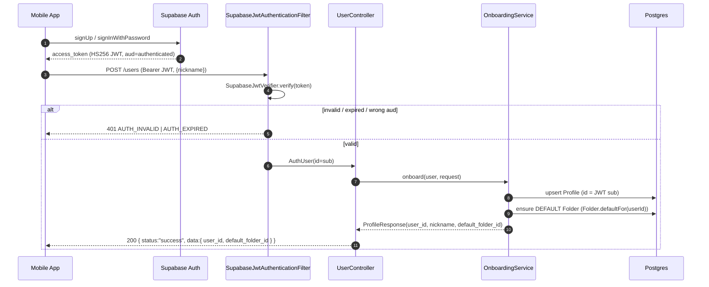
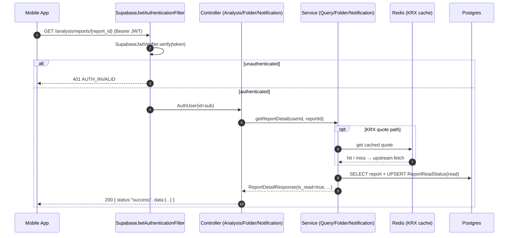

# Architecture — hongik-grad Backend

This document captures the three load-bearing runtime flows of the backend as Mermaid
sequence diagrams. Class, event, and endpoint names match the source exactly so the diagrams
double as a navigation map.

- **Stack**: Java 21, Spring Boot 3.3, Postgres 15 (Supabase), Redis 7, Flyway, Firebase Admin (FCM)
- **Auth model**: Supabase issues HS256 JWTs; the backend only *verifies* them
  (`SupabaseJwtAuthenticationFilter` → `SupabaseJwtVerifier`).
- **Async model**: domain events are published in-process and consumed by
  `@TransactionalEventListener(phase = AFTER_COMMIT)` + `@Async("taskExecutor")` listeners, so a
  consumer never observes uncommitted data and a listener failure never rolls back the producer.

---

## 1. Signup + Onboarding

The mobile client authenticates against Supabase Auth and receives a JWT. The backend never mints
tokens; it verifies the Supabase-signed JWT and performs an idempotent onboarding write (one
`Profile` + one DEFAULT `Folder`).



Onboarding is idempotent: repeated `POST /users` updates only the nickname and never creates a
second DEFAULT folder.

---

## 2. Automatic Report Generation (DART → FCM)

The disclosure pipeline is fully event-driven. A scheduled poll (or a manual `DartPoller.poll()`
call in tests) ingests new DART filings, and two AFTER_COMMIT listeners chain the analysis report
and the notification fan-out.

```mermaid
sequenceDiagram
    autonumber
    participant Sched as DartPollerScheduler
    participant Poller as DartPoller
    participant Client as DartClient
    participant DART as OpenDART API
    participant DS as DisclosureService
    participant DL as DisclosureCreatedListener
    participant Gen as AnalysisReportGenerator
    participant RL as ReportCreatedListener
    participant NS as NotificationService
    participant FCM as FcmSender
    participant DB as Postgres

    Sched->>Poller: poll() (fixedDelay 60s; dart.poller.enabled)
    Poller->>Client: fetchDisclosures(since, pageCount)
    Client->>DART: GET /api/list.json
    DART-->>Client: list (filtered to stock universe)
    Client-->>Poller: List<DartListItem>
    Poller->>DS: upsertBatch(items)
    DS->>DB: INSERT Disclosure (dedup on dart_filing_id)
    DS-)DL: DisclosureCreatedEvent (AFTER_COMMIT, @Async)

    DL->>Gen: generate(disclosureId) [REQUIRES_NEW]
    Gen->>DB: route theme + compute β·Δ contributions
    Gen->>DB: INSERT AnalysisReport
    Gen-)RL: ReportCreatedEvent (AFTER_COMMIT, @Async)

    RL->>NS: fanOutReportCreated(reportId, ticker, title)
    NS->>DB: SELECT distinct favoriting user_ids by ticker
    NS->>DB: INSERT Notification per user
    NS->>FCM: send(deviceToken, title, body, data) per token
    FCM-->>NS: best-effort (failure logged, others unaffected)
```

Both hops use AFTER_COMMIT + `@Async("taskExecutor")`: a failure in report generation or fan-out is
logged and isolated, never rolling back the disclosure ingest.

---

## 3. User-Facing Read Path

Every authenticated screen call passes through the same JWT verification filter, then a thin
controller delegates to a service that reads from Postgres (KRX quote reads additionally hit a
Redis cache).



Reading a report detail UPSERTs a `ReportReadStatus` row, so the `is_read` flag flips to `true` on
first view. Notification read state (`PATCH /notifications/{id}/read`) is tracked separately from
report read state.
